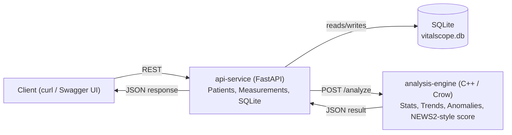

# VitalScope

VitalScope is a two-service system for recording patient vital signs and analyzing them for clinically meaningful patterns: trends over time, threshold-based anomalies (tachycardia, hypoxemia, hyper-/hypotension, fever, ...), and a simplified early warning score loosely modeled after NEWS2.

It started as a portfolio project to practice building a small but properly structured system: a Python API with a real database on one side, a C++ computation engine with its own unit-tested library on the other, talking to each other over HTTP, containerized and covered by CI.

## Architecture



- **api-service** owns the data: patients and their measurements, persisted in SQLite. It validates incoming vitals (e.g. heart rate 20-300 bpm) before they ever reach the database.
- **analysis-engine** owns the clinical logic: given a list of measurements, it computes per-vital statistics and trends, flags anomalies with a severity, and produces an early warning score. It has no knowledge of patients, HTTP, or persistence — it's a plain C++ library with a thin Crow server wrapped around it, so the logic itself stays unit-testable in isolation.
- The two talk to each other only over HTTP, so either one can be developed, tested, and deployed independently.

## Running it

Requires Docker and Docker Compose.

```bash
git clone https://github.com/AmlElmotiem/vitalscope.git
cd vitalscope
docker compose up --build
```

This builds both images and starts them together:
- `api-service` on [http://localhost:8000](http://localhost:8000)
- `analysis-engine` on [http://localhost:8081](http://localhost:8081) (used internally by api-service; you don't need to call it directly)

Interactive API docs (Swagger UI) are available at **[http://localhost:8000/docs](http://localhost:8000/docs)** once the stack is running.

A small script is included to populate the running api-service with a few realistic demo patients (a healthy one, a deteriorating one, and a critical one):

```bash
python scripts/generate_test_data.py
```

## Example requests

Create a patient:

```bash
curl -X POST http://localhost:8000/patients \
  -H "Content-Type: application/json" \
  -d '{"first_name":"Anna","last_name":"Schmidt","birth_date":"1990-05-12","gender":"female"}'
```

Add a measurement for patient `1`:

```bash
curl -X POST http://localhost:8000/patients/1/measurements \
  -H "Content-Type: application/json" \
  -d '{"heart_rate":115,"spo2":91,"systolic_bp":150,"diastolic_bp":95,"temperature":38.5,"respiratory_rate":22}'
```

Get the analysis (stats, trends, anomalies, early warning score) across all of that patient's measurements:

```bash
curl http://localhost:8000/patients/1/analysis
```

## Technologies

- **api-service**: Python, FastAPI, SQLModel, SQLite, httpx, pytest
- **analysis-engine**: C++20, Crow, nlohmann/json, CMake, GoogleTest
- **Infrastructure**: Docker, Docker Compose, GitHub Actions

## Disclaimer

VitalScope is a personal portfolio project. It is **not a certified medical device**, has not undergone any clinical validation, and must not be used to make real medical decisions. All patient data used with it should be simulated or otherwise non-sensitive. Its structure is loosely inspired by ideas from IEC 62304 (e.g. separating and independently testing the clinical logic from the surrounding software), but it does not claim and has not sought compliance with that or any other medical device software standard.
